<div align="center">

# 🚨 DisplaceOS

### AI-Powered Disaster Relief Coordination & Emergency Response Platform

**"When Disaster Strikes, Every Second Matters."**
*One platform. Every rescue. Every resource. Every life.*


[Overview](#-executive-overview) •
[Problem](#-the-problem) •
[Architecture](#-system-architecture) •
[Features](#-core-modules) •
[Quickstart](#-local-setup--quickstart) •
[API](#-rest-api-reference) •
[Roadmap](#-roadmap)

</div>

---

## 📑 Table of Contents

1. [Executive Overview](#-executive-overview)
2. [The Problem](#-the-problem)
3. [Key Principles & Responsible AI](#-key-architectural-principles--responsible-ai)
4. [System Architecture](#-system-architecture)
5. [Data Flow Diagrams](#-data-flow-diagrams)
6. [Data Model (ER Diagram)](#-data-model-er-diagram)
7. [Roles & Demo Accounts](#-live-demo-accounts--roles)
8. [Core Modules](#-core-modules)
9. [AI Triage Engine](#-ai-triage-engine)
10. [Smart Dispatch Engine](#-smart-dispatch-engine)
11. [Security & Privacy](#-security--privacy)
12. [Tech Stack](#-tech-stack)
13. [Project Structure](#-project-structure)
14. [Local Setup & Quickstart](#-local-setup--quickstart)
15. [Environment Variables](#-environment-variables)
16. [REST API Reference](#-rest-api-reference)
17. [WebSocket Events](#-websocket-telemetry)
18. [Testing](#-testing)
19. [Simulation Guide for Evaluators](#-simulation-guide-for-evaluators)
20. [Roadmap](#-roadmap)
21. [Contributing](#-contributing)
22. [License](#-license--attribution)

---

## 📌 Executive Overview

**DisplaceOS** is a production-quality, responsive emergency command and disaster relief platform for civil defense authorities, national rescue taskforces (e.g., NDRF), municipal Emergency Operations Centers (EOC), relief NGOs, and affected citizens.

During floods, structural collapses, landslides, fires, and cyclones, response delays cost lives. DisplaceOS addresses this with:

- 🗺️ **Real-time geospatial intelligence** – one live map of incidents, teams, shelters, hazards and blocked roads
- 🧠 **Deterministic + AI-assisted triage** – P0–P3 classification that works even with no internet/cloud AI
- 🚒 **Automated squad recommendation** – distance, capability and workload-aware dispatch scoring
- 🏠 **Live shelter capacity tracking** – occupancy, supplies, check-in/check-out
- 📦 **Negative-balance-protected logistics** – multi-depot inventory with immutable transaction history
- 🌐 **Multilingual, offline-resilient citizen reporting** – English/Hindi, local draft queue, idempotent sync

---

## ❗ The Problem

| Pain point in real disasters | How DisplaceOS responds |
| :--- | :--- |
| Reports arrive via scattered calls, WhatsApp, and radio — no single picture | One unified incident intake with GPS capture and a live command map |
| Dispatchers manually decide who to send first | Rule-based triage + ranked squad recommendations with explanations |
| Networks degrade exactly when they're needed most | Offline-first reporting with local queue and automatic sync |
| Relief stock is over-allocated or untracked | Transactional inventory with zero-negative-stock protection |
| Shelter capacity is unknown to citizens and responders | Live occupancy and supplies per shelter |
| Decisions are hard to audit after the event | Immutable audit log of every sensitive action |
| Families are separated and can't find each other | Privacy-conscious missing persons workflow |

---

## 🛡️ Key Architectural Principles & Responsible AI

1. **AI Assists, Humans Decide** – AI suggests P0–P3 and flags perils; consequential dispatch orders require dispatcher verification.
2. **Deterministic Safety Baseline** – A rule engine guarantees immediate escalation for entrapment, casualties, or vulnerable individuals even if cloud AI is unreachable (`AI_PROVIDER="rule_engine"`).
3. **Audit Trail Accountability** – Priority overrides, dispatches, alerts, and stock deductions are recorded in the audit log with the acting officer.
4. **Zero-Trust Privacy** – Citizen phone numbers and precise indoor coordinates are redacted for unauthorized viewers.
5. **Offline-First Resilience** – Drafts and queued reports persist in the browser and sync using idempotency keys, preventing duplicates.
6. **Explainability** – Every triage result and dispatch recommendation ships with reasons, risks, and a confidence score.

---

## 🏗️ System Architecture

### High-Level Architecture

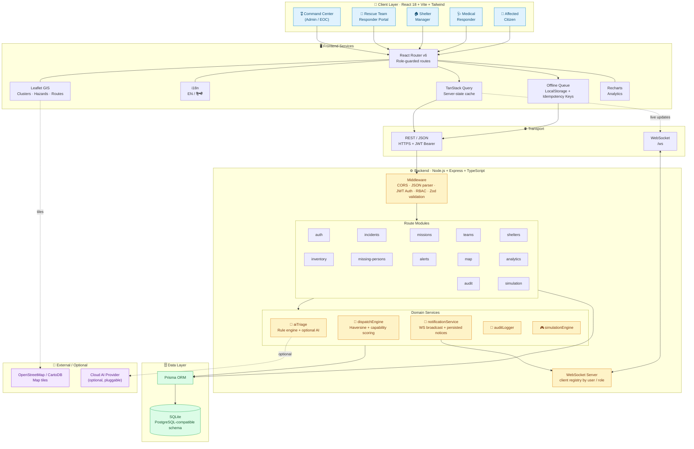

### Layered View

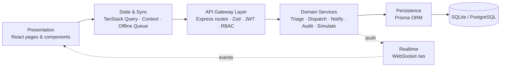

### Deployment Topology

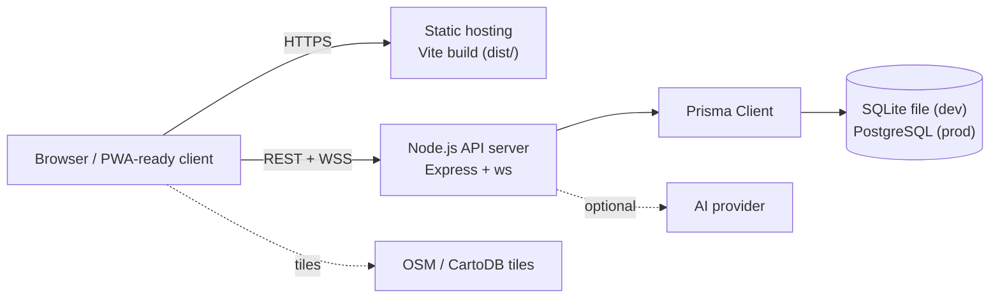

---

## 🔄 Data Flow Diagrams

### 1. Citizen SOS → Triage → Dispatch → Completion

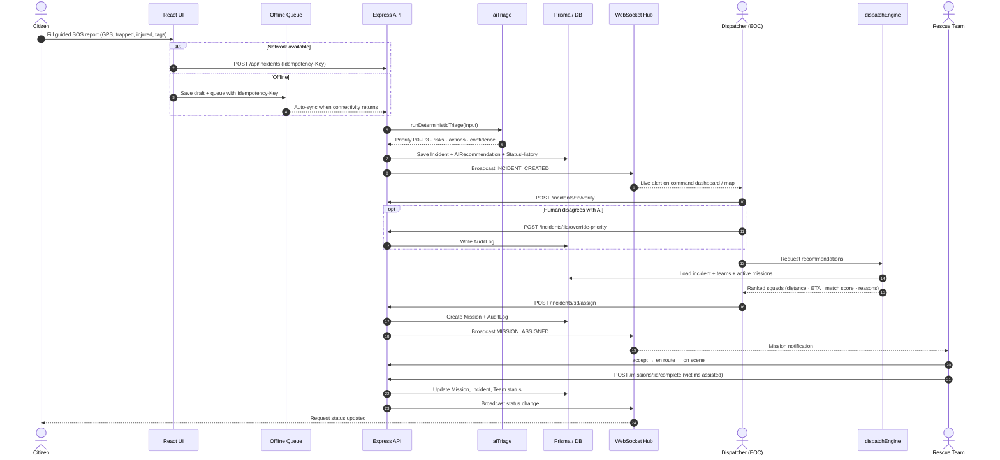

### 2. Incident Lifecycle State Machine

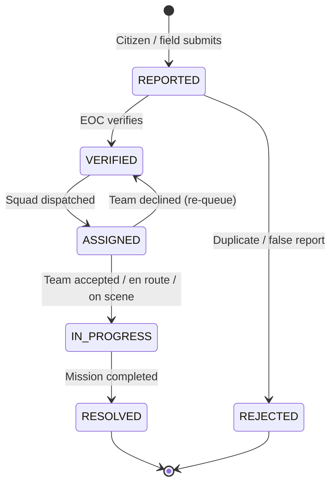

> Exact state names are defined in `backend/prisma/schema.prisma` and the route handlers; the diagram shows the intended lifecycle.

### 3. Mission Status Stepper (Responder Portal)

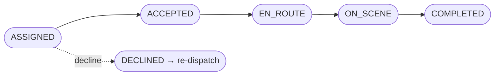

### 4. Inventory Transaction Safety

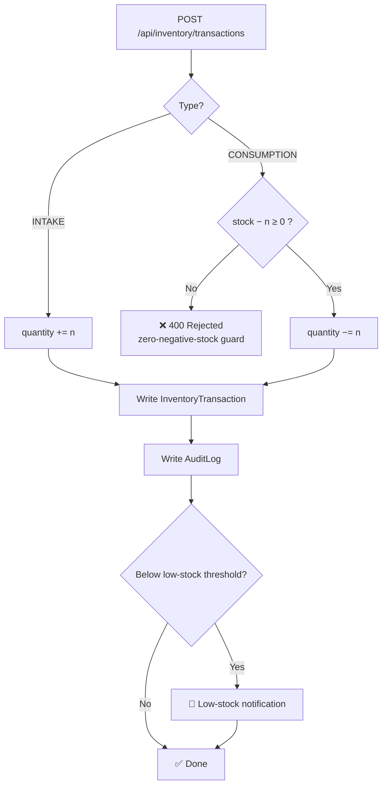

### 5. Offline-First Sync

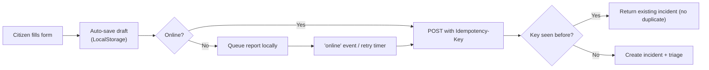

---

## 🗃️ Data Model (ER Diagram)

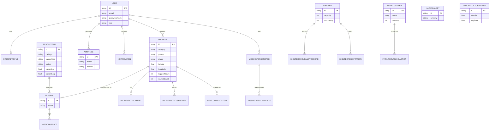

> `HazardAlert` and `RoadBlockageReport` are standalone geospatial entities consumed by the map layer. The diagram shows primary relationships; see `backend/prisma/schema.prisma` for the full field list.

---

## 🚀 Live Demo Accounts & Roles

Click any role pill in the **top simulation bar**, or sign in manually:

| Role | Email | Password | Access Highlights |
| :--- | :--- | :--- | :--- |
| **Command Center (Admin)** | `commander@displaceos.org` | `EmergencyPass2026!` | EOC dashboard, AI triage overrides, fleet dispatch, alerts, audit logs |
| **Rescue Team Leader** | `team.alpha@displaceos.org` | `EmergencyPass2026!` | Missions, accept/decline, status stepper, live GPS telemetry |
| **Shelter Manager** | `shelter.metro@displaceos.org` | `EmergencyPass2026!` | Capacity sliders, supply rations, family check-in/out |
| **Medical Responder** | `medic.sarah@displaceos.org` | `EmergencyPass2026!` | Trauma triage, ALS coordination, hospital referrals |
| **Affected Citizen** | `citizen.rahul@gmail.com` | `EmergencyPass2026!` | Guided SOS, geolocation capture, request tracking, missing persons |

> ⚠️ **Demo credentials only.** Remove the demo-login endpoint, rotate `JWT_SECRET`, and re-seed with unique passwords before any real deployment.

### Role-Based Access Matrix

| Capability | Command | Rescue | Shelter | Medical | Citizen |
| :--- | :---: | :---: | :---: | :---: | :---: |
| Report incident | ✅ | ✅ | ✅ | ✅ | ✅ |
| Verify / override priority | ✅ | – | – | – | – |
| Dispatch squads | ✅ | – | – | – | – |
| Accept / complete missions | – | ✅ | – | – | – |
| Manage shelter capacity | ✅ | – | ✅ | – | – |
| Manage inventory | ✅ | – | ✅ (own supplies) | – | – |
| Issue alerts | ✅ | – | – | – | – |
| View audit logs | ✅ | – | – | – | – |
| Missing persons (report) | ✅ | – | ✅ | – | ✅ |
| Find shelters / view alerts | ✅ | ✅ | ✅ | ✅ | ✅ |

> The matrix reflects intended design; enforcement lives in `backend/src/middleware/auth.ts` and each route.

---

## ⚙️ Core Modules

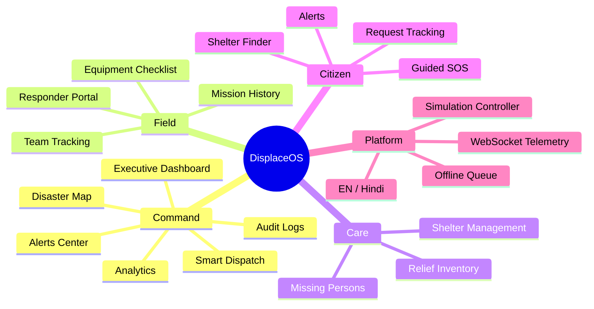

| # | Module | Description |
| :-: | :--- | :--- |
| 1 | **Executive Command Dashboard** | KPIs computed from DB records, severity & category charts, operational feeds |
| 2 | **Disaster Intelligence Map** | Leaflet GIS with clusters, severity indicators, hazard perimeters, road cuts, shelters, route estimates |
| 3 | **Emergency Incident Reporting** | Guided report, GPS capture, entrapment counters, vulnerability tags, drafts, offline sync |
| 4 | **AI Emergency Triage** | P0–P3 with confidence, identified risks, and recommended actions |
| 5 | **Smart Rescue Dispatch** | Haversine distance, capability match, workload balancing → ranked squads |
| 6 | **Responder Portal** | Mission acceptance, status stepper, victim assistance logs |
| 7 | **Shelter Management** | Capacity, occupancy %, supplies (water, food, medical, power), rosters |
| 8 | **Relief Inventory & Logistics** | Multi-depot stock, transaction history, zero-negative guard, low-stock alerts |
| 9 | **Missing Persons & Reunification** | Privacy-conscious reporting, authorized lead updates, search roster |
| 10 | **Alerts & Early-Warning Center** | Hazard bulletins, advisories, mandatory evacuation orders |
| 11 | **Risk & Impact Analytics** | Operational debriefs, response-time distributions, one-click CSV export |
| 12 | **Road Accessibility & Routing** | Log impassable roads, estimate emergency routes |
| 13 | **Accessibility & Multilingual UI** | English/Hindi toggle, high-contrast readability, WCAG 2.2 AA principles |
| 14 | **Low-Network & Offline-First** | LocalStorage drafts & queue with automatic sync |
| 15 | **Real-Time Telemetry** | WebSocket broadcasting of incidents, dispatches, status changes |
| 16 | **System Audit Logs** | Immutable log of sensitive actions with officer identifiers |
| 17 | **Simulation Controller** | Surge incidents, move GPS, consume supplies, close roads |
| + | **Thermal Recon & 4K Command Center** | Thermal reconnaissance portal and large-display command view |

---

## 🧠 AI Triage Engine

The deterministic engine (`backend/src/services/aiTriage.ts`) scores each report, then maps score and hard rules to a priority.

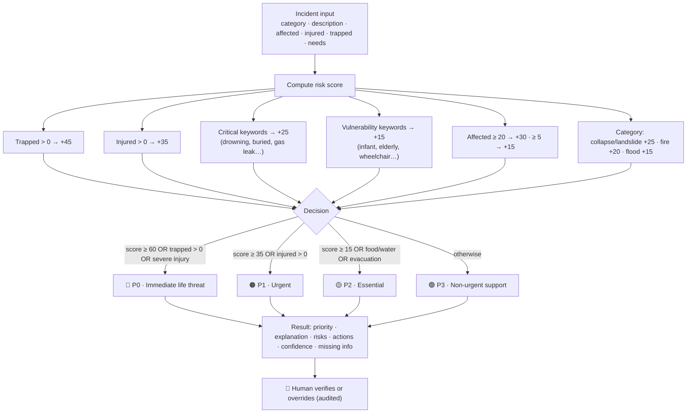

| Priority | Meaning | Target response |
| :-: | :--- | :--- |
| 🔴 **P0** | Immediate life threat | Dispatch without queue delay |
| 🟠 **P1** | Urgent | Assign within ~20 minutes |
| 🟡 **P2** | Essential | Scheduled evacuation / relief logistics |
| 🟢 **P3** | Non-urgent | Monitor / community support |

---

## 🚒 Smart Dispatch Engine

`backend/src/services/dispatchEngine.ts` ranks every rescue team against an incident.

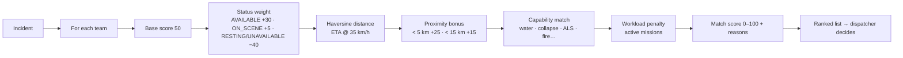

**Distance:** Haversine great-circle distance, with `R = 6371 km`.

```
a = sin²(Δφ/2) + cos φ₁ · cos φ₂ · sin²(Δλ/2)
d = 2R · atan2(√a, √(1−a))
```

---

## 🔐 Security & Privacy

| Area | Implementation |
| :--- | :--- |
| Authentication | JWT bearer tokens; passwords hashed with `bcryptjs` |
| Authorization | Role-based access control via auth middleware |
| Input validation | `zod` schemas on request payloads |
| PII protection | Phone numbers and indoor coordinates redacted for unauthorized viewers |
| Accountability | `AuditLog` records actor, action, and target for sensitive operations |
| Idempotency | Client-generated keys prevent duplicate offline submissions |
| Data integrity | Transactional inventory updates; negative stock blocked |

### Production Hardening Checklist

- [ ] Replace `JWT_SECRET` with a strong secret from a secrets manager
- [ ] Restrict CORS to your real frontend origin (the code currently allows `*` for demo convenience; `CORS_ORIGIN` is defined in env)
- [ ] Disable / remove `POST /api/auth/demo-login` and simulation endpoints
- [ ] Re-seed with unique credentials; remove demo accounts
- [ ] Serve behind HTTPS/WSS (reverse proxy such as Nginx or Caddy)
- [ ] Add rate limiting and security headers (`express-rate-limit`, `helmet`)
- [ ] Move from SQLite to PostgreSQL and enable backups
- [ ] Authenticate WebSocket connections and scope broadcasts by role
- [ ] Add monitoring and structured logging

---

## 🛠️ Tech Stack

| Layer | Technologies |
| :--- | :--- |
| **Frontend** | React 18, TypeScript, Vite, Tailwind CSS, Lucide React, React Router v6, TanStack Query, Leaflet & React-Leaflet, Recharts |
| **Backend** | Node.js, Express, TypeScript, Prisma ORM, SQLite (PostgreSQL-compatible), `ws`, Zod, JWT, bcryptjs |
| **Realtime** | WebSocket server at `/ws` |
| **Testing** | Vitest + Supertest |
| **Tooling** | `concurrently`, `ts-node`, Prisma CLI |

---

## 📂 Project Structure

```
DisplaceOS/
├── package.json                 # Root scripts: setup, dev, build, test
├── backend/
│   ├── prisma/
│   │   ├── schema.prisma        # Data model (20 models)
│   │   └── seed.ts              # Rich disaster demo data
│   └── src/
│       ├── index.ts             # Express app + WebSocket server (/ws)
│       ├── config.ts            # Environment configuration
│       ├── prisma.ts            # Prisma client singleton
│       ├── middleware/
│       │   └── auth.ts          # JWT + RBAC
│       ├── routes/              # auth · incidents · missions · teams · shelters
│       │                        # inventory · missingPersons · alerts · map
│       │                        # analytics · audit · simulation
│       ├── services/
│       │   ├── aiTriage.ts          # Deterministic triage rules
│       │   ├── dispatchEngine.ts    # Haversine + capability scoring
│       │   ├── notificationService.ts  # WS broadcast + notifications
│       │   ├── auditLogger.ts       # Audit trail writer
│       │   └── simulationEngine.ts  # Demo scenario generator
│       └── tests/               # triage.test.ts · integration.test.ts
└── frontend/
    ├── public/images/           # Hero, thermal and card imagery
    └── src/
        ├── App.tsx              # Router + role guards
        ├── components/          # TopCommandBar · LeftSidebar · LeafletMap
        │                        # IncidentDetailDrawer · SimulationBanner · StatusBadge
        ├── context/             # AuthContext · LanguageContext · SimulationContext
        ├── i18n/translations.ts # English / Hindi strings
        ├── services/            # api.ts · offlineQueue.ts
        ├── types/index.ts
        └── pages/
            ├── public/          # Landing · Login · Features · Safety · About · Resources
            ├── command/         # Dashboard · Map · Incidents · Dispatch · Teams
            │                    # Shelters · Inventory · Alerts · Analytics · Audit
            │                    # ThermalRecon · 4K Command Center
            ├── responder/       # Dashboard · Missions · History · Team Status · Checklist
            ├── shelter/         # Dashboard · Registrations · Capacity · Supplies
            └── citizen/         # Dashboard · Report · My Requests · Shelters
                                 # Missing Persons · Alerts
```

---

## 💻 Local Setup & Quickstart

### Prerequisites

- Node.js **v18+** (tested on v24)
- npm **v9+**

### 1. Install & seed

```bash
# From the project root
npm run setup
```

This installs backend dependencies, generates the Prisma client, pushes the schema to SQLite, seeds demo data, and installs frontend dependencies.

### 2. Configure environment

```bash
cd backend
cp .env.example .env   # skip if backend/.env already exists
```

### 3. Run development servers

```bash
npm run dev
```

| Service | URL |
| :--- | :--- |
| 🖥️ Frontend Command Center | http://localhost:5173 |
| ⚙️ Backend REST API | http://localhost:5000/api/health |
| 📡 WebSocket Telemetry | `ws://localhost:5000/ws` |

### 4. Test & build

```bash
npm test          # backend unit + integration tests
npm run build     # production bundles (backend + frontend)
```

### Reset the demo database

```bash
cd backend
npm run prisma:push -- --force-reset
npm run prisma:seed
```

### Troubleshooting

| Problem | Fix |
| :--- | :--- |
| `EADDRINUSE :5000` | Change `PORT` in `backend/.env` and update the frontend API base URL |
| Blank map tiles | Check internet access to OpenStreetMap/CartoDB tile servers |
| Prisma client errors | Run `cd backend && npm run prisma:generate` |
| Empty dashboards | Re-run `npm run prisma:seed` in `backend/` |
| CORS errors | Make sure the frontend runs on `http://localhost:5173` |

---

## 🔧 Environment Variables

| Variable | Default | Description |
| :--- | :--- | :--- |
| `PORT` | `5000` | Backend HTTP/WebSocket port |
| `NODE_ENV` | `development` | Runtime mode |
| `DATABASE_URL` | `file:./dev.db` | Prisma datasource (swap for PostgreSQL URL in production) |
| `JWT_SECRET` | *(demo value)* | **Change in production** |
| `CORS_ORIGIN` | `http://localhost:5173` | Allowed frontend origin |
| `AI_PROVIDER` | `rule_engine` | Triage provider; the deterministic engine is always the safety baseline |

---

## 📡 REST API Reference

Base URL: `http://localhost:5000/api` · Auth: `Authorization: Bearer <JWT>`

### Auth
| Method | Endpoint | Description |
| :--- | :--- | :--- |
| POST | `/auth/login` | Authenticate and receive JWT |
| POST | `/auth/demo-login` | One-click evaluation login for any role |

### Incidents
| Method | Endpoint | Description |
| :--- | :--- | :--- |
| GET | `/incidents` | List incidents (filter by category, priority, status) |
| POST | `/incidents` | Report incident with automatic triage |
| POST | `/incidents/:id/verify` | Verify community report (EOC) |
| POST | `/incidents/:id/override-priority` | Human priority override (audited) |
| POST | `/incidents/:id/assign` | Dispatch rescue squad |

### Map & Teams
| Method | Endpoint | Description |
| :--- | :--- | :--- |
| GET | `/map/all-layers` | Incidents, shelters, teams, hazards, road cuts in one payload |
| GET | `/map/route-estimate` | Distance, waypoints, ETA |
| GET | `/teams` | Fleet tracking and availability |

### Missions
| Method | Endpoint | Description |
| :--- | :--- | :--- |
| GET | `/missions` | Responder mission queue |
| POST | `/missions/:id/accept` | Squad accepts mission |
| POST | `/missions/:id/complete` | Complete mission with victim count |

### Shelters & Inventory
| Method | Endpoint | Description |
| :--- | :--- | :--- |
| GET | `/shelters` | Directory and live occupancy |
| POST | `/shelters/:id/check-in` | Family arrival check-in |
| GET | `/inventory` | Depot stock |
| POST | `/inventory/transactions` | Record consumption or intake |

### Alerts, Analytics & Audit
| Method | Endpoint | Description |
| :--- | :--- | :--- |
| GET | `/alerts` | Hazard early-warning notices |
| GET | `/analytics/overview` | KPIs computed from DB |
| GET | `/analytics/export-csv` | Operational summary CSV |
| GET | `/audit` | Immutable compliance log |
| — | `/missing-persons` | Missing person cases and lead updates |

### Simulation (evaluators only)
| Method | Endpoint | Description |
| :--- | :--- | :--- |
| POST | `/simulation/spike` | Trigger incident volume surge |
| POST | `/simulation/move-teams` | Advance responder GPS |
| POST | `/simulation/consume-supplies` | Deduct depot stock |
| POST | `/simulation/road-closure` | Trigger impassable road |

### Example: Report an incident

```bash
curl -X POST http://localhost:5000/api/incidents \
  -H "Authorization: Bearer $TOKEN" \
  -H "Content-Type: application/json" \
  -d '{
    "category": "FLOOD",
    "title": "Family stranded on rooftop",
    "description": "Rising water, elderly woman and two children on roof",
    "affectedPeople": 4,
    "injuredCount": 0,
    "trappedCount": 4,
    "requiredAssistance": "Boat rescue",
    "latitude": 28.6139,
    "longitude": 77.2090
  }'
```

Expected: the incident is created with `recommendedPriority: "P0"` (entrapment), plus identified risks and suggested actions.

---

## 📡 WebSocket Telemetry

Connect to `ws://localhost:5000/ws` (optionally with user and role identifiers so the server can target messages).

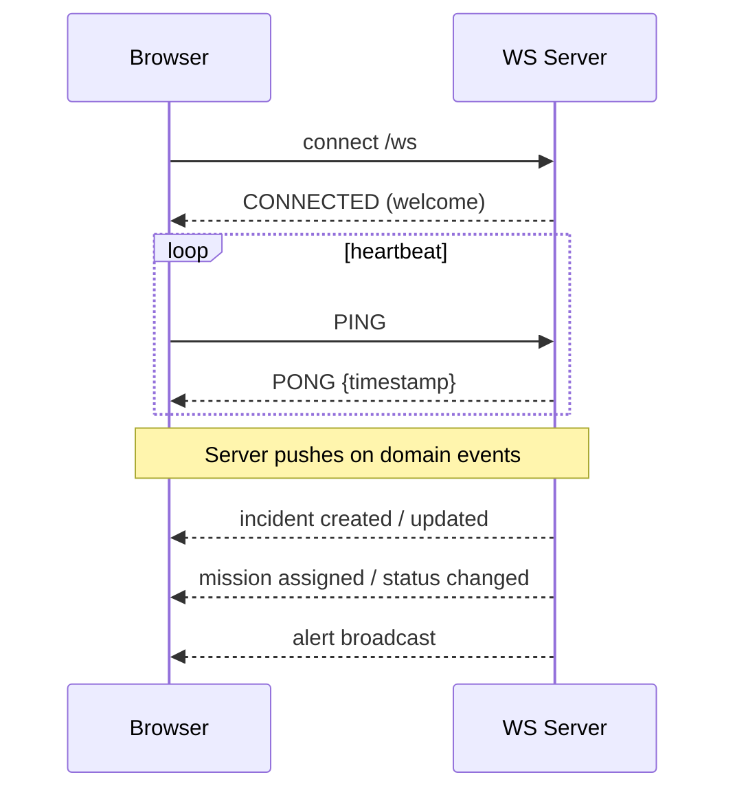

---

## 🧪 Testing

```bash
npm test
```

| Suite | Coverage |
| :--- | :--- |
| `triage.test.ts` | P0–P3 classification rules, escalation guarantees |
| `integration.test.ts` | API flows, geospatial distance, inventory integrity, shelter constraints |

---

## 🎮 Simulation Guide for Evaluators

Use the sticky **top simulation bar**:

1. **Switch roles** with the role pills to see each persona's view.
2. **Spike incidents** (+3) → watch the dashboard, map, and WebSocket feed update live.
3. **Dispatch** a P0 incident → inspect ranked squads and the reasoning.
4. **Move teams** → see responder GPS advance on the map.
5. **Consume supplies** → trigger low-stock alerts and check the transaction log.
6. **Close a road** → observe route estimates adapt.
7. Open **Audit Logs** as Commander to verify every action was recorded.

---

## 🗺️ Roadmap

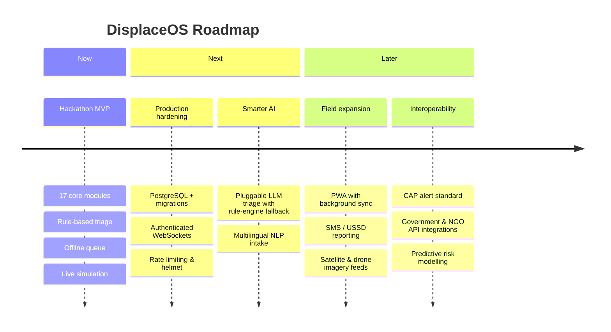

---

## 🤝 Contributing

1. Fork the repo and create a branch: `git checkout -b feature/your-feature`
2. Make changes and add tests where relevant
3. Run `npm test` and `npm run build`
4. Open a pull request describing the change and its operational impact

Please never commit real personal data, credentials, or production secrets.

---

## 📄 License & Attribution

DisplaceOS is open-source software built for humanitarian disaster management.
Map tiles © [OpenStreetMap](https://www.openstreetmap.org/copyright) contributors and © [CARTO](https://carto.com/attributions) under their open attribution standards.

<div align="center">

**Built to save time. Built to save lives. 🚨**

</div>
